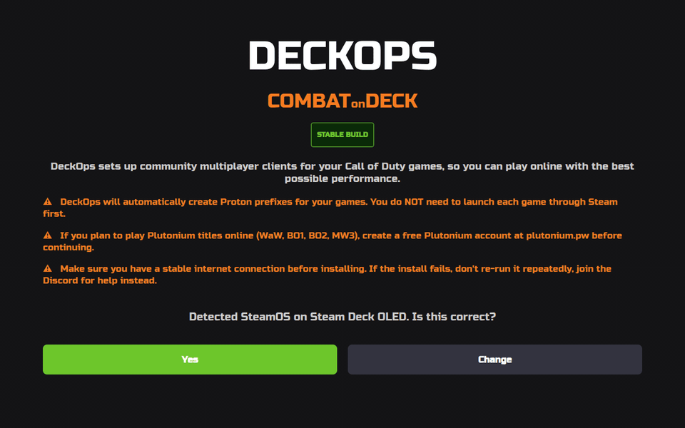

  Bringing the Golden Age of Call of Duty to your Steam Deck and other Linux handhelds and devices, no tinkering required.™️

  

---

> **This is the Stable build of DeckOps. For the newest features before they land here, try [DeckOps Nightly](https://github.com/GalvarinoDev/DeckOps-Nightly).**

---

## Supported Games

| Game | Client | Online | Aim Assist |
|---|---|:---:|:---:|
| Call of Duty | [IW-Pad](https://github.com/GalvarinoDev/IW-Pad) + [CoD1x](https://github.com/xtnded/codextended-client) | ✅ | SP |
| Call of Duty: United Offensive | [IW-Pad](https://github.com/GalvarinoDev/IW-Pad) + [CoDUOx](https://github.com/xtnded/codextended-client-uo) | ✅ | SP |
| Call of Duty: Finest Hour | [Finest Hour Remastered](https://github.com/crazyriddler/FinestHourRemastered) | ❌ | ✅ |
| Call of Duty 2 | [IW-Pad](https://github.com/GalvarinoDev/IW-Pad) + [CoD2x](https://github.com/callofduty2x/CoD2x) | ✅ | SP |
| Call of Duty 2: Big Red One | [BRO Custom Engine](https://github.com/SmokeDoggy044/CoD2-BRO-Native-Loader) | ❌ | ✅ |
| Call of Duty 3 | [CoD3Recomp](https://github.com/FrankHUN88453/CoD3Recomp) | ❌ | ✅ |
| Call of Duty 4: Modern Warfare | [IW3SP-MOD](https://gitea.com/JerryALT/iw3sp_mod) + [CoD4R](https://iw3x.com/) | ✅ | ✅ |
| Call of Duty: Modern Warfare 2 | [IW-Pad](https://github.com/GalvarinoDev/IW-Pad) + [iw4x](https://iw4x.io) | ✅ | ✅ |
| Call of Duty: Modern Warfare 3 | [IW-Pad](https://github.com/GalvarinoDev/IW-Pad) + [Plutonium](https://plutonium.pw) | ✅ | ✅ |
| Call of Duty: Ghosts | [IW6-Mod](https://github.com/alterware/client-files) | ✅ | ✅ |
| Call of Duty: Advanced Warfare | [S1-Mod](https://github.com/alterware/client-files) | ✅ | ✅ |
| Call of Duty: World at War | [Plutonium](https://plutonium.pw) | ✅ | ✅ |
| Call of Duty: Black Ops | [Plutonium](https://plutonium.pw) | ✅ | ✅ |
| Call of Duty: Black Ops II | [T6SP-Mod](https://github.com/Rattpak/T6SP-Mod-Release) + [Plutonium](https://plutonium.pw) | ✅ | ✅ |
| Call of Duty: Black Ops III | [CleanOps](https://github.com/notnightwolf/cleanopsT7) | ✅ | ✅ |

IW-Pad and AlterWare do not repair the remote code execution (RCE) vulnerabilities in MW2 SP and MW3 SP. We do not recommend that you play Special Ops in MW2 or MW3. If you play Special Ops, you do so at your own risk.

DeckOps supports Steam Deck (LCD and OLED), Steam Machine, Legion Go / Go S / Go 2, ROG Ally / Ally X / Xbox Ally X, MSI Claw 8, Retroid Pocket 6, and PC. It supports SteamOS, Bazzite, CachyOS, and Armada.

The AlterWare developer discontinued Ghosts and Advanced Warfare in September 2026. DeckOps will officially discontinue support for these games in January 2027.

Controls, multiplayer clients and extras

All titles use controller and gyro through Steam Input. You choose your gyro mode during setup (ADS, Hold, or Toggle). IW-Pad adds controller support and aim assist to MW2 SP and MW3 SP, and to Call of Duty, United Offensive, and Call of Duty 2 SP.

Multiplayer uses CoD1x for Call of Duty, CoDUOx for United Offensive, and CoD2x for Call of Duty 2. CoD4x is available as an alternative MW1 MP client during setup.

DeckOps can also install [Zombies Declassified](https://github.com/Logo-2K/zombies-declassified). This mod adds 10 Zombies maps to BO2 Zombies. You must have all the BO2 Zombies DLC.

---

## Plutonium Offline

How Plutonium Offline works

With Plutonium Offline, you can play WaW, BO1, BO2, and MW3 without an internet connection.

1. On the setup screen, select **Plutonium Offline**.
2. DeckOps adds the **DeckOps: Plutonium Offline** launcher to your Steam library.
3. To start a game, open the launcher. You can also select **Play Plutonium Offline** in the Steam launch menu of the game.

In Offline Multiplayer, DeckOps starts a local server with bots. You can also play Campaign and Zombies offline in WaW and BO1, and Zombies offline in BO2.

Plutonium Offline uses a separate instance of Plutonium. It does not interact with your online files.

---

## Before You Install

1. Install your games on Steam first. You do not need to launch them.
2. Have a stable internet connection ready.
3. Plutonium requires a [free account](https://forum.plutonium.pw/register). You must log in one time during the install. After the install, you can play offline on all devices.
4. MW3, Ghosts, and AW require a depot downgrade. DeckOps downloads [DepotDownloader](https://github.com/SteamRE/DepotDownloader) and uses your Steam account to get the correct game files. You log in through a QR code during the install.

Disc games and patch versions

- Call of Duty 3 has no PC release. Put your own Xbox 360 disc image (.iso, or a .zip with the .iso inside) in a folder named `cod3` in `~/Games` or in `Games` on your SD card. DeckOps installs [CoD3Recomp](https://github.com/FrankHUN88453/CoD3Recomp) and extracts the game next to it. CoD3Recomp is in early development. The first time each level loads, the picture smears for a minute or two while its shaders build. After that, the level loads normally.
- Call of Duty: Finest Hour has no PC release. Put your own Xbox disc image (.iso, or a .zip with the .iso inside) in a folder named `finesthour` in `~/Games` or in `Games` on your SD card. Only the PAL (Europe) release works. DeckOps downloads [Finest Hour Remastered](https://github.com/crazyriddler/FinestHourRemastered) (about 5 GB) and installs it from your disc (about 10 GB).
- Call of Duty 2: Big Red One has no PC release. Put your own Xbox disc image (.iso, or a .zip with the .iso inside) in a folder named `bro` in `~/Games` or in `Games` on your SD card. DeckOps installs the [BRO Custom Engine](https://github.com/SmokeDoggy044/CoD2-BRO-Native-Loader) and copies the game files from your disc. The engine runs natively on Linux, without Proton.
- Disc releases of Call of Duty 2 must have patch 1.3 for multiplayer. Disc releases of United Offensive must have patch 1.51.

---

## Installation

1. Press the Steam button → **Power** → **Switch to Desktop**.
2. Open a browser and go to this GitHub page.
3. Download the **[DeckOps file](https://github.com/GalvarinoDev/DeckOps/releases/download/v1/DeckOps.desktop)**.
4. Right-click the file → **Properties** → **Permissions** → tick **"Is executable"** → OK.
5. Double-click it.
   - **First time:** DeckOps installs and launches automatically.
   - **Already installed:** A menu appears with Launch and Uninstall options.

DeckOps checks for updates on every launch. Updates download only the changed files. Your config, logs, and music are never overwritten.

---

## After Installation

Click Continue when installation finishes. DeckOps reopens Steam automatically. First launches take longer while Proton prepares the game.

If Steam asks about cloud saves, choose **Keep Local**. If asked about safe mode or hardware changes, choose **No**.

Notes for single games

- **MW1 and WaW.** Use the main entry for SP and the DeckOps shortcut for MP. On the first MW1 SP launch, select the profile with your player name ("Player" if you did not set a name).
- **MW2 MP (Non-Steam).** Start MW2 MP two times after the first install. The first launch fails. The second launch works.
- **BO3.** CleanOps finishes its install on the first launch. Do the first launch in Desktop Mode. If the game does not start, press Stop in Steam and start it again.
- **MW3 MP.** If the downgrader fails with a depot access error, add the free MW3 Dedicated Server tool to your Steam account. Paste `steam://install/42750` in a browser or Steam's URL bar, then run the downgrader again.
- **LCD Steam Deck.** DeckOps fixes Plutonium on the LCD Steam Deck. DeckOps does not change hardware IDs and does not help you avoid bans. Plutonium games can take a moment to start while the shader cache cleanup runs. If Steam asks to compile Vulkan shaders, skip it. To exit faster, quit from the in-game menu.

---

## Gyro Controls

Gyro modes

DeckOps installs a controller profile for every game. Choose your gyro mode during setup, or change it in **Settings > Controller Profiles > Re-apply Templates**. R5 is push-to-talk in all modes.

| Mode | How it works | Devices |
|---|---|---|
| **ADS** | Gyro activates when you aim down sights | Deck / Steam Controller |
| **Hold** | Gyro activates while L5 is held | Deck / Steam Controller |
| **Toggle** | L5 press on / L5 press off | Deck / Steam Controller |
| **On / Off** | Simple toggle | Legion Go, ROG Ally, MSI Claw 8, PC |

---

## Settings

All settings

| Option | What it does |
|---|---|
| Background Music | Turn on/off and adjust volume |
| Controller Profiles | Switch gyro mode and re-apply controller templates |
| Player Name | Change your in-game name in all games |
| Shader Cache (LCD only) | Clear shader cache data for all set-up games |
| Check for Updates | Check for and apply DeckOps updates |
| Full Uninstall | Remove everything DeckOps installed (backs up saves first) |
| Reset DeckOps Config | Wipe config and run setup again |
| Links | Discord, Stable repo, and Nightly repo |

---

## Troubleshooting

https://discord.gg/bkSQeq5Azk

---

## Credits

DeckOps is an installer. This project would not exist without years of foundational work from these teams:

**[CoD4R](https://iw3x.com/)** - MW1 MP client (Call of Duty 4: Revived) by [k/divity](https://github.com/Divity). Native controller support, aim assist, server browser, and bot support. [Website](https://iw3x.com/) | [Discord](https://discord.com/invite/uWAuFzru34) | 💰 [Ko-fi](https://ko-fi.com/divity)

**[CoD4x](https://cod4x.ovh)** - MW1 MP alternative client. [GitHub](https://github.com/callofduty4x)

**[IW3SP-MOD](https://gitea.com/JerryALT/iw3sp_mod)** - MW1 SP client by [JerryALT](https://gitea.com/JerryALT).

**[IW-Pad](https://github.com/GalvarinoDev/IW-Pad)** - Controller support and aim assist for Call of Duty, United Offensive, Call of Duty 2, MW2, and MW3 SP.

**[CoD1x](https://github.com/xtnded/codextended-client)** - Call of Duty MP client by [xtnded](https://github.com/xtnded). **[CoDUOx](https://github.com/xtnded/codextended-client-uo)** is the United Offensive MP client, from the [CBServers](https://github.com/CBServers) builds.

**[CoD2x](https://github.com/callofduty2x/CoD2x)** - Call of Duty 2 MP patch. [GitHub](https://github.com/callofduty2x)

**[iw4x](https://iw4x.io)** - MW2 MP client. [GitHub](https://github.com/iw4x)

**[AlterWare](https://github.com/alterware)** - Ghosts (IW6-Mod) and Advanced Warfare (S1-Mod) clients.

**[CleanOps](https://github.com/notnightwolf/cleanopsT7)** - Black Ops III mod by [notnightwolf](https://github.com/notnightwolf).

**[T6SP-Mod](https://github.com/Rattpak/T6SP-Mod-Release)** - Black Ops II SP client by [Rattpak](https://github.com/Rattpak).

**[CoD3Recomp](https://github.com/FrankHUN88453/CoD3Recomp)** - Call of Duty 3 PC port (static recompilation of the Xbox 360 game) by [FrankHUN88453](https://github.com/FrankHUN88453).

**[Finest Hour Remastered](https://github.com/crazyriddler/FinestHourRemastered)** - Call of Duty: Finest Hour PC port (static recompilation of the original Xbox game with a remastered renderer) by [crazyriddler](https://github.com/crazyriddler).

**[BRO Custom Engine](https://github.com/SmokeDoggy044/CoD2-BRO-Native-Loader)** - Call of Duty 2: Big Red One native Linux engine by [SmokeDoggy044](https://github.com/SmokeDoggy044).

**[Plutonium](https://plutonium.pw)** - MW3, WaW, BO1, and BO2 client. 💰 [Donate](https://forum.plutonium.pw/donate)

**[Bot Warfare](https://github.com/ineedbots)** - Bots for Plutonium Offline in WaW, BO1, BO2, and MW3 by [ineedbots](https://github.com/ineedbots).

**[T6ServerConfigs](https://github.com/xerxes-at/T6ServerConfigs)** - BO2 game mode settings for Plutonium Offline by [xerxes-at](https://github.com/xerxes-at).

**[Zombies Declassified](https://github.com/Logo-2K/zombies-declassified)** - DLC5 map pack for BO2 Zombies (10 classic maps) by [Logo2K](https://github.com/Logo-2K). Files packaged and hosted by **[Littlegods](https://github.com/andr3xcl/littlegods-dlc-installer)**.

**[DepotDownloader](https://github.com/SteamRE/DepotDownloader)** - Steam depot downloader by [SteamRE](https://github.com/SteamRE). Used to download the correct game files for MW3, Ghosts, and AW.

Official Test Team: [LeFinnaBust](https://github.com/LeFinnaBust) and Special Agent Dale Cooper

---
**[Call of Duty Alt Launcher](https://github.com/framilano/CallofDutyAltLauncher)** - Inspiration for DeckOps.

**[LanLauncher](https://github.com/JugAndDoubleTap/LanLauncher)** - Inspiration for offline LAN mode.

Steam artwork from [SteamGridDB](https://www.steamgriddb.com) - thanks to [Moohoo](https://www.steamgriddb.com/profile/76561198009314736), [jarvis](https://www.steamgriddb.com/profile/76561198103947979), [Ramzej](https://www.steamgriddb.com/profile/76561198122547176), [Over](https://www.steamgriddb.com/profile/76561198049670875), [Uravity-PRO](https://www.steamgriddb.com/profile/76561198167607660), [Maxine](https://www.steamgriddb.com/profile/76561198130550992), [caukyy](https://www.steamgriddb.com/profile/76561198031582867), [Middle](https://www.steamgriddb.com/profile/76561198027273869), [Hevi](https://www.steamgriddb.com/profile/76561198018073166), [europeOS](https://www.steamgriddb.com/profile/76561198038608428), [Empti](https://www.steamgriddb.com/profile/76561198022992095), [grimlokk](https://www.steamgriddb.com/profile/76561199034037601), [Mr.Parks](https://www.steamgriddb.com/profile/76561198018403239), [Dankheili](https://www.steamgriddb.com/profile/76561198040056867), [FaN](https://www.steamgriddb.com/profile/76561198015449572), [adamboulton](https://www.steamgriddb.com/profile/76561198143575007), [ActualCj](https://www.steamgriddb.com/profile/76561198135110632), [KimaRo](https://www.steamgriddb.com/profile/76561197985524535), [Gector(lint)Nathan](https://www.steamgriddb.com/profile/76561198319864298), [increasing](https://www.steamgriddb.com/profile/76561198041593264), [xamon](https://www.steamgriddb.com/profile/76561197979282373), [jakearty](https://www.steamgriddb.com/profile/76561199079444502), [dragnus](https://www.steamgriddb.com/profile/76561198015793633), [Onyx8011](https://www.steamgriddb.com/profile/76561198125292564), [MλRI](https://www.steamgriddb.com/profile/76561199074946914), [LordGriffith](https://www.steamgriddb.com/profile/76561198119743032), [PopASquatt](https://www.steamgriddb.com/profile/76561197977494754), [Mikachuuu_](https://www.steamgriddb.com/profile/76561198206047256), [r_dsgnd](https://www.steamgriddb.com/profile/76561198355292092), [calculon559](https://www.steamgriddb.com/profile/76561198047532194), [CluckenDip](https://www.steamgriddb.com/profile/76561198120642113), [WesleyTRV](https://www.steamgriddb.com/profile/76561198353392770), [Haxy](https://www.steamgriddb.com/profile/76561198205566017), [Winchester7314](https://www.steamgriddb.com/profile/76561198039231307), [thatRdude](https://www.steamgriddb.com/profile/76561198138819685), [YoungFlexerOG](https://www.steamgriddb.com/profile/76561198286450036), and [OnSync](https://www.steamgriddb.com/profile/76561198061208589).

**[Claude](https://claude.ai)** by Anthropic - assisted in development.

---

> DeckOps is not affiliated with Activision, Infinity Ward, Treyarch, or Valve. All trademarks belong to their respective owners. A legitimate copy of each game is required. DeckOps does not provide or distribute game files.

## License

[MIT License](LICENSE)
